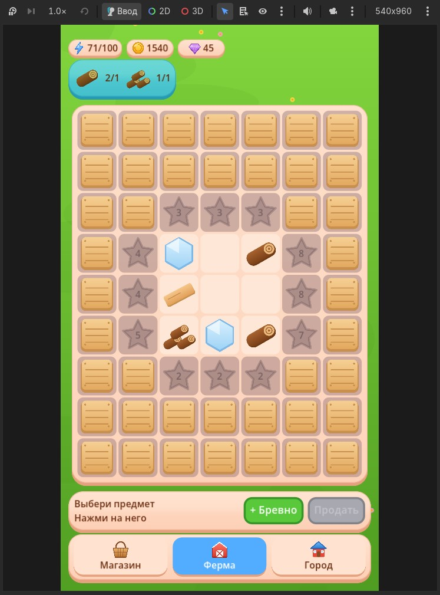
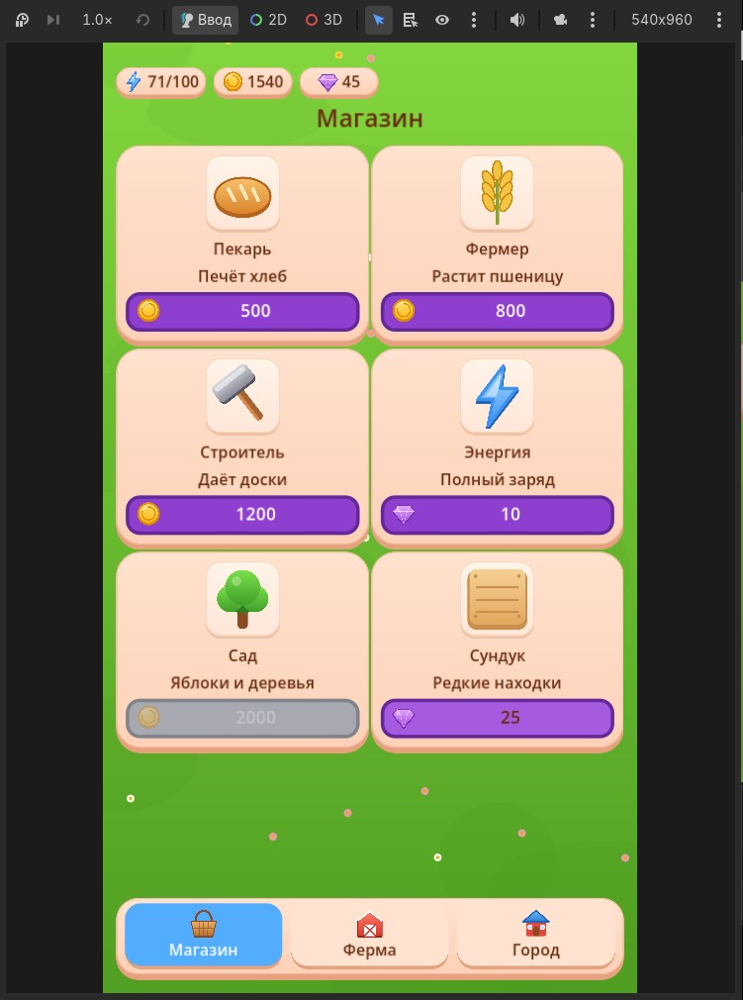
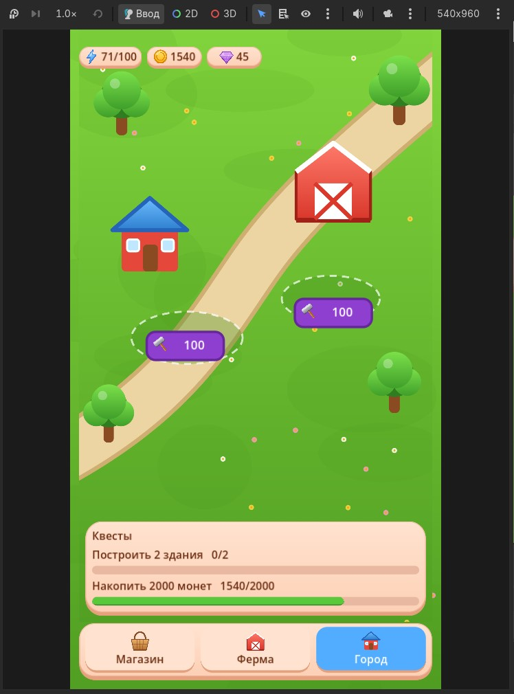

# Merge Village UI: три экрана для мерж-игры на Godot

Демо-проект технического UI-художника: ферма с полем слияния, магазин и город с квестами. Собран в Godot 4 с общей темой, компонентами и проверкой на разных разрешениях.

**Автор:** [Имя] · [почта / Telegram]

| | |
|---|---|
| Видео (30 секунд) | [demo_cropped.mp4](demo_cropped.mp4) |
| Страница кейса | [index.html]([index.html](https://steelykt.github.io/HappyVille/)) |
| Проект Godot | папка [project](project) |

## Экраны

<table>
<tr>
<td></td>
<td></td>
<td></td>
</tr>
<tr><td align="center">Ферма</td><td align="center">Магазин</td><td align="center">Город</td></tr>
</table>

Разные разрешения: [360×800](screenshots/HV_farm_360x800.jpg), [540×960](screenshots/HV_farm_540x960.jpg), [768×1024](screenshots/HV_farm_768x1024.jpg).

## Что внутри

- **Тема:** общий `ui_theme.tres` с типами-вариациями для панелей, кнопок, вкладок и подписей, панели на 9-slice.
- **Раскладка:** контейнеры (`VBox`, `Grid`, `ScrollContainer`, `AspectRatioContainer`), без абсолютных координат.
- **Масштаб:** базовое разрешение 1080×2160, растягивание `canvas_items` с `expand`.
- **Состояние:** автозагрузка `GameState` (энергия, монеты, кристаллы). Покупка, стройка и действия на ферме обновляют шапку.
- **Навигация:** три вкладки, экраны подгружаются в общий контейнер.
- **Состояния кнопок:** обычная, наведение, нажатие, недоступная.

## Стиль

| Назначение | Цвет |
|---|---|
| Панель / кромка | `#FDD7BE` / `#E5A07E` |
| Текст | `#6A2C10` |
| Синий / зелёный / фиолетовый | `#52ACFF` / `#59C93B` / `#8F3FD0` |
| Золото | `#FFC92E` |

Скругления 30–56 px, нижняя кромка 6–12 px, округлый жирный шрифт.

## Что решал по ходу

- Углы панелей «плыли»: текстуры были в двойном размере, а поля 9-slice считались под обычный. Экспорт в 1x, поля = радиус плюс нижняя кромка.
- Края пилюль в шапке ломались, потому что высота элемента была меньше суммы верхнего и нижнего полей. Сделал меньшую текстуру и минимальную высоту.
- Список в магазине схлопывался: у `ScrollContainer` не был включён «Развернуть».
- Цифры в шапке не обновлялись: подключил их к сигналу общего состояния.

## Как запустить

1. Установить [Godot 4.7](https://godotengine.org/download).
2. Импортировать `project/project.godot`.
3. Запустить (F5). Размер окна для проверки задаётся в Project Settings → Display → Window (Window Width/Height Override).

## ИИ-инструменты

Использовал ИИ-ассистента для заготовок графики (иконки, кнопки, панели в SVG) и кода, разбора ошибок и сверки раскладки. Выбор стиля, сборку сцен и темы, проверку на разных размерах и исправление проблем делал сам.

## Важно

Проект создан как тестовая работа и не связан с Rumata Games. Игра Happyville Merge Farm и её материалы принадлежат правообладателю. Графика этого репозитория нарисована заново и не копирует ассеты игры.
